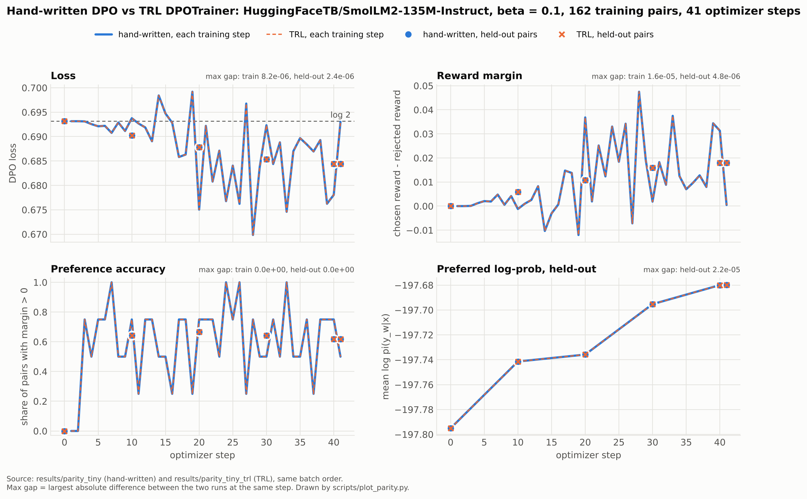

# tiny-rlhf


Preference learning on a small language model, built from scratch: a reward model, DPO written by hand and checked against the TRL library, then applied to one measurable behavior.
The figure shows the DPO loss function itself, evaluated by this repo's `dpo_loss`: every run starts at log 2 because the policy starts equal to the reference, and beta sets how sharply a pair stops pushing once the policy favours the preferred response.
It is a picture of the loss function, not of a trained model.

## Status

**Work in progress. Every training run so far is a small check that the code works. There are no findings about DPO on a real model yet.**

| Milestone | Code and tests | Runs |
|---|---|---|
| M0 loss functions | done | not applicable |
| M1 hand-written DPO training | done | tiny runs on CPU and on a Colab T4; full run not done |
| M2 TRL parity | done | tiny pair on CPU; full pair not done |
| M3 reward model | done | none yet |
| M4 on-task dataset (Track B) | done, with [datasheet](docs/DATASHEET.md) | not applicable |
| M5 Track B training and evaluation | done | none yet |
| M6 ablation sweeps and write-up | sweep tooling done | none yet |
| Stretch: REINFORCE on a toy | done, see [docs/REINFORCE.md](docs/REINFORCE.md) | done on CPU |

Nothing in M3, M5 or M6 has been run on a GPU. The plan, the milestone criteria and the decision log (including every failure so far and its fix) are in [docs/PLAN.md](docs/PLAN.md). A concept-by-concept walkthrough is in [docs/STUDY_GUIDE.md](docs/STUDY_GUIDE.md).

## Checks run so far (none of these is a result about DPO)

### The hand-written loop matches TRL step for step



`configs/parity_tiny.yaml` trains the same LoRA adapter on `HuggingFaceTB/SmolLM2-135M-Instruct` twice, once with this repo's loop and once with TRL 1.18.0's `DPOTrainer`, from the same initial weights and with the same pairs in the same order (162 training pairs, 42 held-out pairs, 41 optimizer steps, CPU, float32). Numbers are from `results/parity_tiny/parity_summary.json`.

- Across all 41 training steps the two losses differ by at most 8.2e-06 and the preference accuracy is identical at every step.
- On the held-out pairs the losses differ by at most 2.4e-06.
- Both start at 0.693147, which is log 2.

This is evidence that the hand-written implementation computes what TRL computes, at tiny scale and in float32. It has not been repeated on the full model or under fp16.

### Smoke test of the training loop


`configs/dpo_tiny.yaml`, same model and data sizes but with shuffling: held-out loss 0.693147 before training and 0.6826 after 41 steps, with 31 of 42 held-out pairs ranked the right way relative to the reference (`results/dpo_tiny/`). The same config on a Colab T4 under fp16 gave 0.6825 and 30 of 42 in 19.75 seconds with a 3.9 GB peak (`results/dpo_tiny_t4/`). The exact-order parity run above ended at 26 of 42. Forty-two pairs is far too few to read anything into those differences, and more than half of the responses were cut at 256 tokens.

### REINFORCE on an enumerable toy


A 5,012-parameter policy over 4,096 possible sequences, small enough that the optimal policy of the KL-constrained objective is computed exactly. With a baseline, hand-written REINFORCE ends within 0.01 nats (KL) of that optimum; without one it ends 0.695 away. Numbers are from `results/reinforce_toy/`, mean of 5 seeds. It is a toy: nothing here is a result about language models.

## What is here

- `src/tiny_rlhf/losses.py`: `sequence_logprob`, `dpo_loss`, `bradley_terry_loss`.
- `src/tiny_rlhf/data.py`: pair tokenization and batching, checked to match TRL's collator.
- `src/tiny_rlhf/train_dpo.py`: the hand-written DPO training loop.
- `src/tiny_rlhf/train_trl.py`: the same run through TRL's `DPOTrainer`.
- `src/tiny_rlhf/reward_model.py`: an explicit reward model trained with the Bradley-Terry loss.
- `src/tiny_rlhf/trackb/`: generator, checks, training and evaluation for the on-task dataset in `data/trackb/`.
- `src/tiny_rlhf/noise.py`, `sweeps.py`: label noise, the robust DPO loss and the sweep runner.
- `src/tiny_rlhf/reinforce.py`: REINFORCE with baselines on the toy task.
- `scripts/`: one script per run or figure. `tests/`: checks against hand-computed values and against TRL.
- `docs/COLAB.md`, `COLAB_TRACKB.md`, `COLAB_SWEEPS.md`: running on a Colab GPU. These cells have not all been executed.

## Run it

```bash
pip install -e ".[dev,train,viz]"
pytest
python scripts/train_dpo.py --config configs/dpo_tiny.yaml
python scripts/plot_training.py --run results/dpo_tiny
```
