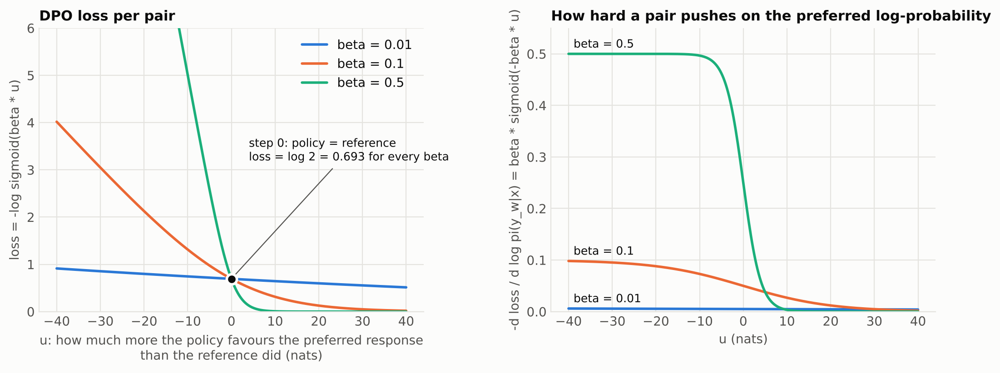

# tiny-rlhf



Preference learning on a small language model, built from scratch: a reward model, DPO written by hand and checked against the TRL library, then applied to one measurable behavior.
The figure shows the DPO loss function itself, evaluated by this repo's `dpo_loss`: every run starts at log 2 because the policy starts equal to the reference, and beta sets how sharply a pair stops pushing once the policy favours the preferred response.
It is a picture of the loss function, not of a trained model.

## Status

**Work in progress. No model has been trained yet and there are no results.**

| Milestone | State |
|---|---|
| M0 loss functions (`sequence_logprob`, `dpo_loss`, `bradley_terry_loss`) | done, unit tested on toy tensors and a toy bigram model only |
| M1 hand-written DPO training | not started |
| M2 TRL parity run | not started |
| M3 reward model | not started |
| M4 behavior dataset | not started |
| M5 behavior training and evaluation | not started |
| M6 ablations and write-up | not started |

The plan, the milestone criteria and the decision log are in [docs/PLAN.md](docs/PLAN.md).

## What is here

- `src/tiny_rlhf/losses.py`: the three loss building blocks in plain PyTorch.
- `tests/test_losses.py`: checks against hand-computed values (log 2 at the start, gradient directions and exact gradient values, response-only masking with the one-position shift).
- `scripts/plot_loss_shape.py`: makes the figure above and writes its numbers to `results/m0_loss_shape.csv`.

## Run it

```bash
pip install -e ".[dev,viz]"
pytest
python scripts/plot_loss_shape.py
```
